# Quy trình DUU DUU

Ba sơ đồ quy trình bán hàng của shop:

1. **Phía shop** (chủ shop và nhân viên): chuẩn bị hàng, trả lời khách, hoàn thành đơn, cuối ngày, và khiếu nại / bom hàng khi có.
2. **Phía khách mua trên chợ 3D**: từ lúc mở link đến khi nhận hàng.
3. **Tổng quan một trang**: 3 kênh (Live, Chợ Zalo, Chợ 3D) cùng đổ về bảng Gom đơn, rồi sang file tháng và Dashboard. Các thẻ T1–T5 là 5 điểm khách và shop gặp nhau.

Bản vẽ swimlane đầy đủ (có chú thích, ghi chú tiết kiệm thời gian, nút thu vừa màn hình): mở `index.html` trong trình duyệt.

## Sửa sơ đồ

- Mã Mermaid của từng sơ đồ nằm trong các file `.mmd`. Dán vào https://mermaid.live để xem và sửa, hoặc chép vào một khối ```` ```mermaid ```` trong file `.md` trên GitHub.
- Bản vẽ trong `index.html` lấy dữ liệu từ các khối `SD1`, `SD2`, `SD3` trong thẻ `<script>`: mỗi nút có làn (`l`), cột (`c`), hàng (`r`), loại (`t`) và chữ (`x`). Sửa chữ hoặc thêm nút ở đó.

## Ký hiệu

| Ký hiệu | Ý nghĩa |
|---|---|
| Ô viền đậm | Bước làm tay |
| ⚡ | Bước chợ 3D hoặc Google Sheets tự làm |
| ⚠️ viền đỏ | Tốn công nhất: đi tìm size trong kho, trả lời hàng trăm tin nhắn |
| ⚠️ viền cam | Tốn công vừa: tính tiền từng khách, dán đơn vào sheet ngày |
| Hình thoi | Rẽ nhánh |
| Hình bình hành / ô nét đứt | Tin hoặc tiền gửi tới từ khách, ngân hàng, SPX |
| 🔗 T1–T5 | Điểm gặp nhau: T1 tin chốt đơn Zalo · T2 xác nhận size · T3 chuyển khoản cọc · T4 tin báo tổng tiền · T5 mã vận đơn |

## Sơ đồ 1: Phía shop

```mermaid
flowchart LR
  %% SƠ ĐỒ 1 — PHÍA SHOP DUU DUU (chủ shop và nhân viên)
  %% Mỗi subgraph là một làn. Đọc từ trái sang phải: A chuẩn bị hàng → B trả lời khách → C hoàn thành đơn
%% → D khiếu nại, bom hàng (chỉ khi có).
  %% Ký hiệu: viền đậm = làm tay · ⚡ = chợ 3D hoặc Google Sheets tự làm
%%          ⚠️ viền đỏ = tốn công nhất (tìm size, trả lời tin) · ⚠️ viền cam = tốn công vừa
  %%          hình bình hành = tin/tiền từ khách hoặc sàn gửi tới · 🔗 T1–T5 = điểm gặp khách (xem Sơ đồ 3)

  classDef tay fill:#FFFFFF,stroke:#1B2458,stroke-width:3px,color:#1B2458
  classDef tudong fill:#EFE9FF,stroke:#8B5CF6,stroke-width:1.5px,color:#1B2458
  classDef nghen fill:#FFECEB,stroke:#E5484D,stroke-width:3px,color:#1B2458
  classDef nghen2 fill:#FFF3E0,stroke:#E07B00,stroke-width:3px,color:#1B2458
  classDef tudongnghen2 fill:#EFE9FF,stroke:#E07B00,stroke-width:3px,color:#1B2458
  classDef quyetdinh fill:#FFC93C,stroke:#1B2458,stroke-width:1.5px,color:#1B2458
  classDef ngoai fill:#FFFFFF,stroke:#5A6190,stroke-width:1.5px,stroke-dasharray:5 4,color:#1B2458
  classDef ketthuc fill:#1B2458,stroke:#1B2458,color:#FFC93C

  subgraph L1["Chủ shop"]
    direction LR
    A1["Nhận hàng từ nguồn hàng"]
    A2["Chụp hoặc lấy ảnh mẫu<br/>(ảnh trải sàn + ảnh bé mặc)"]
    A3["Bán trên livestream trước<br/>~100 đơn/ngày"]
    A4["Live xong, đăng chợ Zalo:<br/>mỗi mẫu 1 album + 1 đoạn chữ<br/>(luôn có size, giá, mô tả),<br/>đăng giống nhau vào 10 nhóm"]
    A5["Bỏ ảnh vào thư mục anh/,<br/>dán nguyên đoạn chữ Zalo<br/>vào data/san-pham.js"]
    A6["Chủ shop đẩy lên GitHub"]
    B0[/"Tin từ live: khách đã bình luận mã,<br/>nhắn shop để cọc và chốt<br/>(đã chọn sẵn mẫu + size)"/]
    B1[/"Tin từ chợ Zalo: ảnh mẫu + cân nặng,<br/>chiều cao bé, shop phải tư vấn size"/]
    B3["⚠️ 🔗 T1 Đọc và trả lời tin Zalo:<br/>chủ shop + nhân viên cùng trả lời<br/>(hàng trăm tin mỗi ngày)"]
    Bq{"Cần kiểm<br/>size?"}
    B5{"Còn size<br/>không?"}
    B6["Báo khách hết,<br/>gợi ý size hoặc mẫu khác"]
    B8{"Đủ 2 bộ<br/>chưa?"}
    B9["Nhắc khách chọn thêm"]
    B10["🔗 T2 Xác nhận đơn, gửi quy định cọc<br/>kèm số tài khoản + mã QR<br/>(50k từ 2 bộ · 100k từ 4 bộ · 500k sỉ từ 20 bộ)<br/>Chưa cọc thì không giữ hàng"]
    B11[/"🔗 T3 Khách chuyển khoản cọc,<br/>gửi biên lai"/]
    C1{"Khách thêm món?<br/>(còn hạn dồn)"}
    C5["🔗 T4 Gửi tin tổng tiền cho khách<br/>(khách chuyển khoản hết thì COD 0đ)"]
    C8["🔗 T5 Gửi khách link mã vận đơn<br/>+ lưu ý quay video bóc hàng<br/>+ “đã có mã vận đơn thì<br/>không chuyển khoản nữa”"]
    C12["Ghi tiền khách chuyển khoản<br/>vào file theo dõi.<br/>Đối soát COD tự động, không kiểm lại"]
    C14(["Xem tab “Theo nguồn”:<br/>chợ 3D mang về bao nhiêu đơn"])
    K1[/"Khách báo khiếu nại"/]
    K2{"Có video<br/>bóc hàng?"}
    K3["Không giải quyết"]
    K4{"Thiếu hàng<br/>hay hàng lỗi?"}
    K5{"Còn hàng<br/>để bù?"}
    K6["Gửi bù, freeship"]
    K7["Hoàn tiền"]
    K9["Bù tiền theo tỷ lệ lỗi"]
    K10["Ghi nhớ khách bom hàng:<br/>lần sau không bán nữa"]
  end

  subgraph L2["Nhân viên · 2 full-time, 2 part-time"]
    direction LR
    B4["⚠️ 2 nhân viên đi tìm size trong kho.<br/>Còn size thì nhanh, hết size thì lâu<br/>(50 đơn chợ: tìm size + lên đơn ~2 tiếng)"]
    B12["Nhập từng món vào tab “Nhập đơn”:<br/>ngày, nguồn (Live / Chợ Zalo / Chợ 3D),<br/>tên khách, mã mẫu, size, màu, SL, giá"]
    B14["Ghi “Đã cọc” + trạng thái<br/>ở tab “Gom theo khách”"]
    C2["Thêm dòng vào “Nhập đơn”<br/>(tin chợ 3D ghi “DỒN ĐƠN”,<br/>cọc thêm theo tổng số bộ cả đơn)"]
    C6["Đóng gói"]
    C6b["Đã cọc mà hết hàng:<br/>khách chọn hoàn cọc hoặc đổi mẫu"]
    C9["Cập nhật “Đã đi đơn”<br/>+ mã vận đơn"]
    C10["⚠️ Cuối ngày: dán 4 cột<br/>(Tên khách, SL, Doanh thu, Cọc)<br/>vào sheet ngày của file tháng"]
  end

  subgraph L3["Google Sheets"]
    direction LR
    B13["⚡ Bảng tự gom các món theo khách"]
    C3["⚡ Bảng tự cộng dồn<br/>vào đơn của khách"]
    C4["⚡ ⚠️ Bảng tự ra tin báo khách<br/>129x5+89+59+25-100=718<br/>(giá × số bộ + ship − cọc = COD)<br/>thay cho tính tay"]
    C13["⚡ Dashboard tự tổng hợp"]
  end

  subgraph L4["Chợ 3D / GitHub"]
    direction LR
    A7["⚡ Chợ tự đọc giá, dải size,<br/>size thiếu, combo (99k/4 quần)"]
    A8["⚡ Trang chợ tự cập nhật<br/>sau 1–2 phút"]
    B2[/"⚡ Tin chốt soạn sẵn từ chợ 3D:<br/>“Nguồn: Chợ 3D”, tên Zalo,<br/>mỗi món: mã · size · màu · SL · giá,<br/>tiền hàng, ship, cọc, COD + dòng “Tính”<br/>(giống đơn live: đã có mẫu + size)"/]
    B7["Chủ shop ghi “ko có size X” hoặc het: true<br/>vào file dữ liệu, đẩy GitHub.<br/>Giỏ nào đã có món đó cũng báo và khoá gửi"]
  end

  subgraph L5["SPX"]
    direction LR
    C7["Lên đơn SPX, lấy mã vận đơn.<br/>Khách đã chuyển khoản hết<br/>thì ghi COD 0đ"]
    C11[/"SPX trả tiền COD<br/>vào thứ 2, 4, 6"/]
    K8[/"Khách không nhận hàng (bom hàng),<br/>SPX hoàn về"/]
  end

  %% Giai đoạn A — chuẩn bị hàng mỗi ngày
  A1 --> A2 --> A3 --> A4 --> A5 --> A6 --> A7 --> A8

  %% Giai đoạn B — trả lời khách
  A4 -. khách xem chợ Zalo .-> B1
  A8 -. khách đặt trên chợ 3D .-> B2
  B0 --> B3
  B1 --> B3
  B2 --> B3
  B3 --> Bq
  Bq -->|"Có: chợ Zalo, chợ 3D,<br/>live khi khách yêu cầu"| B4
  Bq -->|"Không: đơn live<br/>(thường không cần kiểm)"| B8
  B4 --> B5
  B5 -->|Hết| B6 --> B7
  B6 -->|khách chọn lại| B3
  B5 -->|Còn| B8
  B8 -->|Chưa| B9
  B9 -->|khách chọn thêm| B3
  B8 -->|Đủ| B10 --> B11 --> B12 --> B13 --> B14

  %% Giai đoạn C — hoàn thành đơn (vòng lặp dồn đơn)
  B14 --> C1
  C1 -->|Có| C2 --> C3
  %% Dồn đơn: tối đa 2 lần chốt hoặc 1 tuần, cái nào đến trước. Shop muốn chốt 1 lần đi đơn luôn.
  C3 -->|dồn tối đa 2 lần chốt / 1 tuần| C1
  C1 -->|"Khách bảo đi đơn,<br/>hoặc hết hạn dồn"| C4 --> C5 --> C6 --> C7 --> C8 --> C9 --> C10
  C10 --> C12
  C11 --> C12
  C6 -. hết hàng .-> C6b
  C12 --> C13 --> C14

  %% Giai đoạn D — khiếu nại, bom hàng (chỉ khi có)
  K1 --> K2
  K2 -->|Không| K3
  K2 -->|Có| K4
  K4 -->|Lỗi| K9
  K4 -->|Thiếu| K5
  K5 -->|Còn| K6
  K5 -->|Hết| K7
  K8 --> K10

  class A1,A2,A3,A4,A5,A6,B6,B7,B9,B10,B12,B14,C2,C5,C6,C6b,C7,C8,C9,C12,K3,K6,K7,K9,K10 tay
  class A7,A8,B2,B13,C3,C13 tudong
  class B3,B4 nghen
  class C10 nghen2
  class C4 tudongnghen2
  class Bq,B5,B8,C1,K2,K4,K5 quyetdinh
  class B0,B1,B11,C11,K1,K8 ngoai
  class C14 ketthuc
```



## Sơ đồ 2: Khách mua trên chợ 3D

```mermaid
flowchart LR
  %% SƠ ĐỒ 2 — KHÁCH MUA TRÊN CHỢ 3D (từ lúc vào chợ đến khi nhận hàng)
  %% Mỗi subgraph là một làn. Đọc từ trái sang phải.
  %% Ký hiệu: viền đậm = khách làm tay · ⚡ = chợ 3D tự làm · 🔒 = nút bị khoá
  %%          hình bình hành = tin/tiền từ bên ngoài · 🔗 T1–T5 = điểm gặp shop (xem Sơ đồ 3)

  classDef tay fill:#FFFFFF,stroke:#1B2458,stroke-width:3px,color:#1B2458
  classDef tudong fill:#EFE9FF,stroke:#8B5CF6,stroke-width:1.5px,color:#1B2458
  classDef quyetdinh fill:#FFC93C,stroke:#1B2458,stroke-width:1.5px,color:#1B2458
  classDef ngoai fill:#FFFFFF,stroke:#5A6190,stroke-width:1.5px,stroke-dasharray:5 4,color:#1B2458
  classDef ketthuc fill:#1B2458,stroke:#1B2458,color:#FFC93C

  subgraph K["Khách (mẹ bé)"]
    direction LR
    D1(["Thấy link ở profile TikTok<br/>hoặc tin ghim nhóm Zalo, mở link"])
    D3["Nhập tên Zalo, cân nặng bé (kg),<br/>chiều cao bé (cm), bấm “Vào chợ”"]
    D5["Dạo phố chợ đêm: 6 sạp hai bên phố,<br/>sân khấu, gốc đa, cuối phố là cửa hàng.<br/>Bấm tên sạp ở thanh dưới,<br/>hoặc kéo một ngón / chạm nền để đi"]
    D8["Bấm vào một mẫu"]
    D10["Chọn màu<br/>(chợ lật tới ảnh màu đó)"]
    D11["Chọn cân nặng bằng nút − / +"]
    D14["Tuỳ chọn: “Lấy rộng hơn (trừ hao)”,<br/>“Cho bé mặc thử”"]
    D16["Thêm vào giỏ"]
    D17{"Chọn thêm<br/>mẫu?"}
    D18["Mở giỏ: xem món, sửa số lượng,<br/>tên Zalo, chiều cao bé.<br/>Tuỳ chọn: chuyển khoản hết (COD 0đ),<br/>dồn đơn (đã cọc bao nhiêu, đơn trước mấy bộ).<br/>Đọc lưu ý: chưa cọc chưa giữ hàng,<br/>chốt 1 lần, quay video bóc hàng"]
    D22["Bấm “Chép tin và mở Zalo shop”<br/>(chưa ghi tên Zalo thì chợ nhắc ghi)"]
    D24["🔗 T1 Dán tin vào khung chat Zalo,<br/>bấm gửi"]
    D26["🔗 T3 Chuyển khoản cọc theo mã QR<br/>(chưa cọc thì shop không giữ hàng)"]
    D28["Gửi biên lai qua Zalo"]
    D30["🔗 T4 🔗 T5 Nhận tin tổng tiền<br/>và mã vận đơn<br/>(chuyển khoản hết thì COD 0đ)"]
    D32(["Nhận hàng, trả COD,<br/>quay video bóc hàng<br/>(cần khi khiếu nại)"])
  end

  subgraph C["Chợ 3D"]
    direction LR
    D2["⚡ Màn hình vào chợ,<br/>phía sau là chợ đêm quay chậm"]
    D4["⚡ Máy quay bay vào cổng chợ"]
    D6["⚡ Nhân vật tự đi tới sạp,<br/>quay mặt vào sạp"]
    D7["⚡ Đến gần sạp:<br/>hiện dải thẻ mẫu của sạp"]
    D9["⚡ Bảng chi tiết: ảnh thật vuốt ngang,<br/>mã, giá, đoạn chữ của shop"]
    D12{"Size<br/>cho bé?"}
    D13["⚡ 🔒 “Mẫu này chỉ có size X–Y”<br/>hoặc “Hết size”:<br/>khoá nút thêm vào giỏ"]
    D15["⚡ Mặc thử: đóng bảng, nhân vật<br/>mặc màu của mẫu<br/>(ưng thì chạm lại mẫu để thêm)"]
    D19["⚡ Gộp món giống nhau thành số lượng.<br/>Tự tính tiền hàng, ship dự kiến,<br/>cọc theo mốc, COD còn lại<br/>(dồn đơn: cọc thêm theo tổng số bộ,<br/>ship và COD cả đơn để shop cộng)"]
    D20{"Dưới 2 bộ và chưa cọc,<br/>hoặc có món vừa hết size?"}
    D21["⚡ 🔒 Khoá nút gửi,<br/>nhắc chọn thêm hoặc bỏ món hết size"]
    D23["⚡ Chép tin chốt đơn (có “Nguồn: Chợ 3D”),<br/>mở Zalo của shop.<br/>Chép không được: mở ô tin để giữ tay chép.<br/>Zalo không tự mở: nút “Mở Zalo shop” + số Zalo.<br/>Giỏ vẫn lưu trên máy khách"]
  end

  subgraph Z["Zalo shop"]
    direction LR
    D25["🔗 T2 Shop kiểm size trong kho,<br/>xác nhận size và ship"]
    D29["Shop nhập đơn, gửi tin tổng tiền<br/>và mã vận đơn (Sơ đồ 1, giai đoạn C)"]
  end

  subgraph B["Ngân hàng / SPX"]
    direction LR
    D27[/"Ngân hàng nhận tiền cọc"/]
    D31[/"SPX giao hàng, thu COD"/]
  end

  D1 --> D2 --> D3 --> D4 --> D5 --> D6 --> D7 --> D8 --> D9 --> D10 --> D11 --> D12
  D12 -->|Chỉ có size X–Y / Hết size| D13
  D13 -->|chọn mẫu khác| D8
  D12 -->|Có size cho bé| D14
  D14 -. nếu chọn mặc thử .-> D15
  D14 --> D16 --> D17
  D17 -->|Có: dạo tiếp| D5
  D17 -->|Đủ rồi| D18 --> D19 --> D20
  D20 -->|Đúng| D21
  D21 -->|chọn thêm| D5
  D20 -->|Không| D22 --> D23 --> D24 --> D25 --> D26 --> D27 --> D28 --> D29 --> D30 --> D31 --> D32

  class D3,D5,D8,D10,D11,D14,D16,D18,D22,D24,D26,D28,D30,D25,D29 tay
  class D2,D4,D6,D7,D9,D13,D15,D19,D21,D23 tudong
  class D12,D17,D20 quyetdinh
  class D27,D31 ngoai
  class D1,D32 ketthuc
```



## Sơ đồ 3: Tổng quan

```mermaid
flowchart LR
  %% SƠ ĐỒ 3 — TỔNG QUAN MỘT TRANG
  %% 3 kênh bán cùng đổ về bảng “Gom đơn Duu Duu”, rồi sang file tháng và Dashboard.
  %% 🔗 T1–T5 là 5 điểm khách (Sơ đồ 2) và shop (Sơ đồ 1) gặp nhau:
  %%   T1 tin chốt đơn Zalo · T2 xác nhận size · T3 chuyển khoản cọc · T4 tin báo tổng tiền · T5 mã vận đơn
  %% Ký hiệu: viền đậm = làm tay · ⚡ = tự động · ⚠️ viền đỏ = tốn công nhất · ⚠️ viền cam = tốn công vừa

  classDef tay fill:#FFFFFF,stroke:#1B2458,stroke-width:3px,color:#1B2458
  classDef tudong fill:#EFE9FF,stroke:#8B5CF6,stroke-width:1.5px,color:#1B2458
  classDef nghen fill:#FFECEB,stroke:#E5484D,stroke-width:3px,color:#1B2458
  classDef nghen2 fill:#FFF3E0,stroke:#E07B00,stroke-width:3px,color:#1B2458
  classDef ngoai fill:#FFFFFF,stroke:#5A6190,stroke-width:1.5px,stroke-dasharray:5 4,color:#1B2458
  classDef ketthuc fill:#1B2458,stroke:#1B2458,color:#FFC93C

  subgraph K["Khách (mẹ bé)"]
    direction LR
    E1(["Mẹ có bé 7–30kg"])
    E7["🔗 T3 Chuyển khoản cọc<br/>+ gửi biên lai"]
    E11["🔗 T4 Nhận tin tổng tiền<br/>129x5+89+59+25-100=718"]
    E14["🔗 T5 Nhận mã vận đơn, nhận hàng,<br/>trả COD, quay video bóc hàng"]
  end

  subgraph KB["Kênh bán"]
    direction LR
    E2["Livestream<br/>~100 đơn/ngày<br/>khách bình luận mã,<br/>đã chọn sẵn size"]
    E3["Chợ Zalo: 10 nhóm,<br/>~10.000 thành viên<br/>10–15 đơn/ngày"]
    E4["⚡ Chợ 3D (mới): tự kiểm size,<br/>tự tính tiền → Sơ đồ 2<br/>(tin chốt giống đơn live)"]
  end

  subgraph S["Shop (Zalo) — Sơ đồ 1"]
    direction LR
    E5["⚠️ 🔗 T1 Chủ shop + nhân viên<br/>trả lời tin chốt đơn<br/>(hàng trăm tin mỗi ngày)"]
    E6["⚠️ 🔗 T2 2 nhân viên tìm size<br/>trong kho (đơn live thường bỏ qua),<br/>rồi gửi quy định cọc"]
    E12["Đóng gói, lên đơn SPX"]
    E18["Khiếu nại có video: gửi bù,<br/>hoàn tiền hoặc bù theo tỷ lệ lỗi.<br/>Bom hàng: không bán nữa"]
    E17(["Chủ shop xem số ngày, số tháng"])
  end

  subgraph GS["Google Sheets"]
    direction LR
    E8["Gom đơn Duu Duu › Nhập đơn:<br/>mỗi món một dòng,<br/>ghi nguồn Live / Chợ Zalo / Chợ 3D"]
    E9["⚡ Gom theo khách: tự cộng dồn<br/>khi dồn đơn, tự ra tin tổng tiền"]
    E15["⚠️ File tháng: dán 4 cột<br/>vào sheet ngày"]
    E16["⚡ Dashboard + tab “Theo nguồn”<br/>tự tổng hợp, đếm đơn chợ 3D"]
  end

  subgraph SB["SPX / Ngân hàng"]
    direction LR
    E13[/"SPX: mã vận đơn, giao hàng,<br/>thu COD, trả tiền thứ 2, 4, 6"/]
  end

  E1 --> E2 & E3 & E4
  E2 & E3 & E4 --> E5
  E5 --> E6 --> E7 --> E8 --> E9
  E9 -->|dồn tối đa 2 lần chốt / 1 tuần| E8
  E9 --> E11 --> E12 --> E13 --> E14
  E9 -->|cuối ngày: 4 cột| E15
  E13 -->|đối soát COD| E15
  E14 -. khi có .-> E18
  E15 --> E16 --> E17

  class E2,E3,E7,E8,E11,E12,E14,E18 tay
  class E4,E9,E16 tudong
  class E5,E6 nghen
  class E15 nghen2
  class E13 ngoai
  class E1,E17 ketthuc
```



